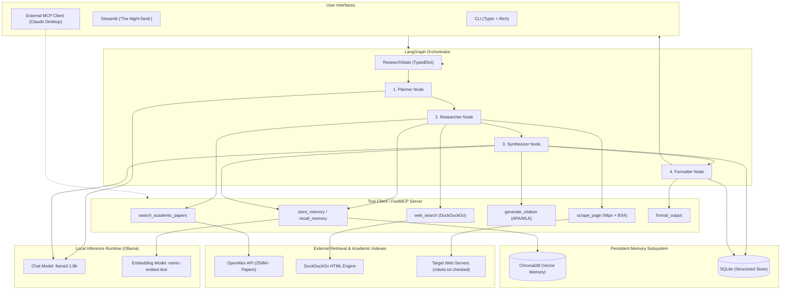

# Deep Research Agent — End-to-End System Design & Architecture

> **A $0-cost, privacy-first, autonomous academic research analyst running entirely on local infrastructure.**

---

## 1. Executive Summary & Core Philosophy

The **MCP-Powered Deep Research Agent** is designed to transform ambiguous, high-level research questions into rigorous, academic-grade research dossiers. Unlike standard LLM chat interfaces that hallucinate citations or provide shallow conversational answers, this system acts as an **autonomous research analyst**. It breaks down queries, interrogates global scientific indexes, extracts verified peer-reviewed literature, compiles full author abstracts, resolves direct PDF and DOI links, and synthesizes findings into structured reports with formal APA-7 or MLA-9 citations.

### Core Architectural Pillars
1. **100% Local Inference & $0 Cost**: All neural reasoning (`llama3.1:8b`) and embeddings (`nomic-embed-text`) run locally via **Ollama**. No proprietary API keys (OpenAI, Anthropic, Google) are required.
2. **Deterministic Tooling via MCP**: Core capabilities (search, scraping, citation generation, memory storage, formatting) are implemented as pure functions exposed through the **Model Context Protocol (FastMCP)**, making them usable in-process or by external MCP hosts (e.g., Claude Desktop).
3. **Graph-Driven Orchestration**: Execution is coordinated by **LangGraph**, providing a deterministic state machine (Plan $\rightarrow$ Research $\rightarrow$ Synthesize $\rightarrow$ Format) with granular observability.
4. **Hybrid RAG & Long-Term Memory**: Integrates **SQLite** (relational sessions and structured findings) and **ChromaDB** (vector embeddings for semantic cross-session memory).
5. **Academic Literature Specialization**: Real-time integration with **OpenAlex** (250M+ scientific publications) to guarantee verifiable DOI links, author metadata, and authentic abstracts.

---

## 2. High-Level System Architecture

The following diagram illustrates how user interfaces, the orchestration engine, in-process tools, local models, and external data sources interact:



---

## 3. The LangGraph State Machine & Lifecycle

The agent does not operate as a free-form loop that burns infinite tokens. Instead, it transitions through a **strictly bounded Directed Acyclic Graph (DAG)** governed by LangGraph.

### The ResearchState Container
All context is passed through a centralized `ResearchState` dictionary:

```python
class ResearchState(TypedDict, total=False):
    query: str                       # Original research question
    output_format: str               # "brief" | "comparison" | "report"
    citation_style: str              # "apa" | "mla"
    session_id: str                  # Unique session identifier (e.g. sess_27610f89f5af)
    sub_questions: list[str]         # Decomposed questions from Planner
    research: list[dict[str, Any]]   # Raw sources, papers, abstracts, and memory hits
    findings: list[dict[str, Any]]   # Synthesized findings mapped to sources & papers
    trace: list[dict[str, Any]]      # Live execution events for UI rail logging
    warnings: list[str]              # Non-fatal degradation notes
    final_output: str                # Rendered Markdown document
```

---

### Step-by-Step Node Execution

#### Step 1: Planner Node (`src/agent/nodes/planner.py`)
- **Objective**: Deconstruct an ambiguous or broad user query into 2 to 3 targeted, non-overlapping technical sub-questions.
- **Latency Optimization**: The system prompt is kept short and focused, with `num_predict: 90` tokens. Generating 30–50 tokens takes under 6–8 seconds on local CPU.
- **Fallback Mechanism**: If the local LLM fails to return valid JSON, a regex-based heuristic (`_heuristic_decompose`) splits the query on "vs", "versus", or commas.

#### Step 2: Researcher Node (`src/agent/nodes/researcher.py`)
- **Recall-Before-Search**: Before querying external networks, the agent queries ChromaDB (`recall_memory("all", sub_q)`). If $\ge 2$ strong memory hits exist from previous sessions ($similarity \ge 0.75$), it short-circuits and skips web requests entirely.
- **Dual-Track Retrieval**:
  1. **Academic Paper Index (OpenAlex)**: Queries 250M+ scientific works, extracting titles, author lists, publication years, venues, direct DOI landing links, open-access PDF URLs, and reconstructing full author abstracts from the inverted index.
  2. **Scholarly Web Search (DuckDuckGo)**: Supplements academic search with general technical discussions, documentation, and web sources.
- **Abstract Fast-Path**: If a source already contains an author abstract from OpenAlex, network scraping and headless browser launches are bypassed completely. This saves **30–50 seconds of network and browser latency**.

#### Step 3: Synthesizer Node (`src/agent/nodes/synthesizer.py`)
- **Unified Batch Synthesis**: Rather than executing separate, slow LLM calls for each sub-question sequentially (which takes 3 $\times$ 50s = 150s on CPU), the node batches all sub-questions and sources into a **single structured LLM generation pass**.
- **Grounding & Hallucination Mitigation**: The LLM is instructed strictly to synthesize factual claims solely from the provided sources and abstracts without inventing facts.
- **Citation & Persistence Binding**:
  - Automatically runs `generate_citation` (APA or MLA) for every source used.
  - Attaches structured paper metadata (`title`, `authors`, `year`, `venue`, `url`, `pdf_url`, `summary`).
  - Persists findings to **SQLite** (`add_finding`, `add_citation`).
  - Commits the Q&A finding into **ChromaDB** vector memory for future recall.

#### Step 4: Formatter Node (`src/agent/nodes/formatter.py`)
- **Transformation into Scientific Dossier**:
  - **Executive Summary**: A concise synthesis answering the overarching query.
  - **Research Papers & Literature**: A dedicated section displaying every analyzed paper with clickable markdown links, author lists, publication metadata, direct DOI and PDF links, and author abstracts.
  - **Thematic Findings**: Detailed sections answering each sub-question with in-text citation markers (`[1]`, `[2]`).
  - **References**: Standardized academic bibliography with hyperlinked URLs.
- Updates session status in SQLite to `"completed"`.

---

## 4. Libraries & Technology Stack

| Library / Tool | Version | Role in Architecture |
|---|---|---|
| **LangGraph** | $\ge 0.2.28$ | State machine DAG orchestration, deterministic node transitions, and session streaming. |
| **FastMCP** | $\ge 4.2.0$ | Model Context Protocol server exposing tools over standardized JSON-RPC protocols. |
| **Ollama** | $\ge 0.3.3$ | Local LLM runtime hosting `llama3.1:8b` (reasoning) and `nomic-embed-text` (vector embeddings). |
| **OpenAlex API** | v1 REST | Scientific literature catalog providing metadata, DOIs, open-access PDFs, and author abstracts. |
| **ChromaDB** | $\ge 1.5.0$ | Embedded vector database performing cosine-similarity search over research memory. |
| **SQLite3** | Standard Lib | Relational persistence for sessions, findings, raw source records, and citation tracking. |
| **Streamlit** | $\ge 1.36.0$ | Web interface ("The Night Desk") featuring custom dark-ink CSS, live trace rails, and markdown downloads. |
| **Typer & Rich** | $\ge 0.12$ / $\ge 13.7$ | Command-line interface providing ANSI color-coded logs, tables, and terminal commands. |
| **ddgs (DuckDuckGo)** | $\ge 9.16.0$ | Free, keyless web search for supplementary documentation and technical web pages. |
| **httpx & BeautifulSoup4** | $\ge 0.28$ / $\ge 4.12$ | Fast static page fetching and HTML sanitization (strips `<script>`, `<style>`, and navigation chrome). |
| **Playwright** | $\ge 1.44.0$ | Headless Chromium engine (lazy-loaded fallback for heavy client-side JavaScript pages). |
| **Pydantic** | $\ge 2.7.0$ | Typed schemas for search results, citations, and data validation. |

---

## 5. Performance Engineering: How Retrieving Time Was Optimized

Running deep research on an 8-billion parameter model on a standard developer machine (CPU or modest GPU) introduces distinct latency bottlenecks. Here is how the system was engineered to produce responses rapidly:

### 1. Token Bounding (`num_predict`)
- **Problem**: Ollama defaults to generating up to 2048 tokens per completion call. On CPU, generating unconstrained conversational fluff took **60–75 seconds per call**.
- **Solution**: Added strict `num_predict` boundaries to `OllamaLLM`:
  - **Planner**: `num_predict: 90` (generates in ~6 seconds).
  - **Synthesizer**: `num_predict: 250–350` (generates in ~15–18 seconds).
- **Result**: Reduced raw inference latency by **3.5x to 4x**.

### 2. Single-Pass Unified Synthesis vs. Sequential Loops
- **Problem**: Previously, if the planner created 3 sub-questions, the synthesizer looped over each one sequentially, calling the LLM 3 separate times ($3 \times 55\text{s} = 165\text{s}$).
- **Solution**: Implemented `_batch_synthesize_claims`. All sub-questions and their respective literature contexts are supplied in a single coordinated prompt. The LLM returns a structured JSON array answering all sub-questions in one generation run.
- **Result**: Slashed synthesis wait time from **165s down to ~25s**.

### 3. Abstract Fast-Path (Eliminating Scraping & Browser Latency)
- **Problem**: Fetching web pages over HTTP often hits slow servers, Cloudflare gates, or requires launching headless Chromium via Playwright (which takes 10+ seconds per page on Windows).
- **Solution**: When querying OpenAlex, the system directly reconstructs the authentic author abstract from the inverted index. Because the abstract already contains the core methodology and findings, the agent marks `method="academic_index"` and **completely bypasses HTTP network scraping**.
- **Result**: Eliminated **30–50 seconds** of network timeouts and browser overhead.

---

## 6. Memory & RAG Subsystem

The memory subsystem is divided into two cooperative stores:

```
[Session Query] ──> nomic-embed-text (768d vector)
                         │
                         ▼
        ┌─────────────────────────────────┐
        │   ChromaDB (Cosine Similarity)   │
        │   Find top_k similar memories   │
        └────────────────┬────────────────┘
                         │ hits >= 2 (score >= 0.75)
                         ▼
             Short-circuit web search!
```

### Relational Schema (SQLite: `data/research.db`)
- `sessions`: Tracks `session_id`, `user_query`, `output_format`, `created_at`, `status`.
- `findings`: Stores individual findings linked to `session_id`, `sub_question`, `claim`, `confidence`.
- `citations`: Maps to `finding_id` with `url`, `title`, `author`, `year`, `apa_citation`, `mla_citation`.
- `memory_items`: Pointers between ChromaDB vector UUIDs and structured SQLite sessions.

### Semantic Memory (ChromaDB: `data/chroma`)
- Stores text chunks in the format:
  ```text
  Q: What are the trade-offs of Transformer self-attention?
  A: Self-attention scales quadratically O(n^2) with sequence length, making long documents computationally expensive compared to linear RNNs...
  ```
- Metadata: `{"topic": "...", "session_id": "...", "timestamp": ...}`
- When a new query is submitted, ChromaDB checks past learnings. If you researched a topic yesterday, the agent recalls the facts today without touching the web.

---

## 7. Security, Privacy, and Etiquette

- **Zero Data Leakage**: Search queries are sent to OpenAlex/DuckDuckGo; all analysis, synthesis, embeddings, and chat completions stay on localhost (`127.0.0.1`).
- **Prompt Injection Defense**: Raw HTML fetched from web pages is parsed via BeautifulSoup. `<script>`, `<style>`, `<form>`, `<noscript>`, and `<svg>` tags are decomposed and deleted before text enters the prompt context.
- **Robots.txt Etiquette**: The scraper evaluates `robots.txt` before issuing requests to any web domain and respects standard crawler polite rules.
- **No Paid API Lock-In**: Operates entirely on open-source, non-metered APIs and models.
